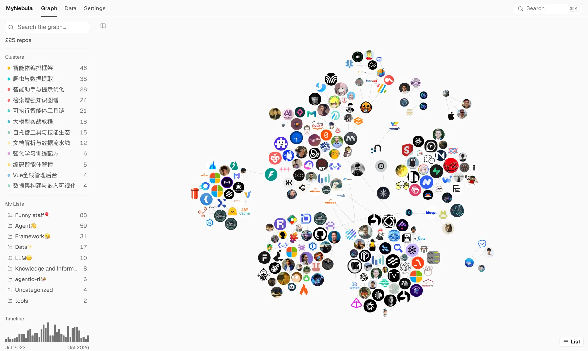
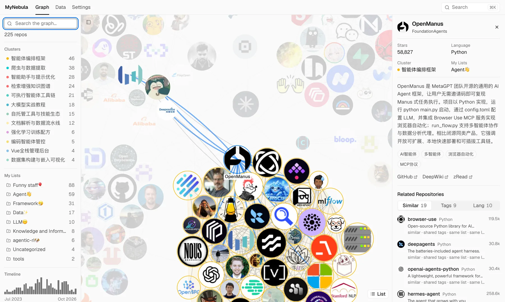
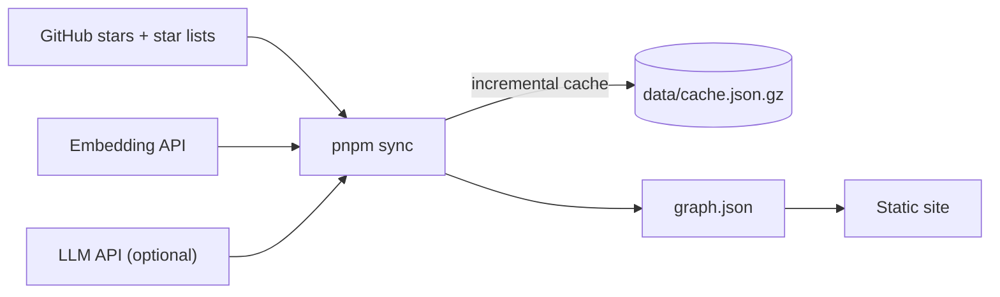

<div align="center">
  <a href="https://github.com/Tendo33/MyNebula">
    
  </a>

  <h1>MyNebula</h1>

  <p><strong>Your GitHub stars as a living semantic graph: related repositories pull together, and you explore by connection instead of scrolling a list.</strong></p>

  <p><a href="README.zh.md">中文</a> | English</p>

  <p>
    
    
    
    <a href="LICENSE"></a>
  </p>
</div>



## What it is

MyNebula reads your GitHub stars, writes a short summary of each repository, and links every repository to the ones it is most similar to. Those links decide both where things sit on the canvas and which group they belong to, so a cluster like "agent frameworks" or "document parsing" appears on its own, without manual tagging.

It ships as a static site plus an offline sync. There is no server and no database: a daily GitHub Actions run refreshes the data and redeploys to GitHub Pages. Reruns only process new or changed stars, so keeping it current costs close to nothing.



## Features

- **Graph** (home): a live force-directed canvas. Groups burst out on load, settle, and drift gently. Hover a repository to preview its group; select one to light up just the repositories it links to.
- **Filters**: group, GitHub star list, timeline range, and text search (`stars:>1000` works too). Every filter and selection lives in the URL, so views are shareable.
- **Details**: summary, tags, links to GitHub / DeepWiki / zRead, and related repositories: the ones it links to on the graph, strongest first, plus same-tag and same-language lists.
- **Data**: a sortable, filterable table of every repository.
- **Search** with `⌘K` / `Ctrl+K` across repositories, groups, languages, and tags.
- English and Chinese UI, light / dark / system theme, keyboard and reduced-motion support.

## How it works



1. **Fetch** every starred repository and your star lists.
2. **Enrich** new or changed repositories only: read the README, optionally write an LLM summary and tags, then compute an embedding.
3. **Link** each repository to its closest neighbours. The score blends embedding similarity (65%), shared tags (20%), same star list (10%), and same language (5%).
4. **Group** the link graph into communities (Louvain). Group ids, colours, and names carry over between syncs.
5. **Export** static JSON. The browser runs the force layout on the links, so nothing about positions is stored.

The pipeline is about 1,200 lines of TypeScript that Node 24 runs directly, with no runtime dependencies. The site uses only `d3-force`.

## Quick start

You need Node 24+, pnpm, a GitHub token, and an embedding API key.

```bash
git clone https://github.com/Tendo33/MyNebula.git
cd MyNebula
pnpm install
cp .env.example .env   # fill in GITHUB_TOKEN and EMBEDDING_API_KEY, optionally LLM_API_KEY
pnpm sync              # writes frontend/public/data/
pnpm dev               # http://localhost:5173
```

For reference, a first sync of 225 stars with LLM summaries took about 5 minutes. The next run reused everything and finished in seconds without any paid calls.

## Configuration

All settings come from environment variables. `.env.example` lists them with comments.

| Variable | Default | Purpose |
| --- | --- | --- |
| `GITHUB_TOKEN` | required | Reads your stars and star lists. |
| `EMBEDDING_API_KEY` | required | Key for the embedding endpoint. |
| `EMBEDDING_BASE_URL` | `https://api.siliconflow.cn/v1` | Any OpenAI-compatible endpoint. |
| `EMBEDDING_MODEL` | `BAAI/bge-m3` | Multilingual, works well for mixed Chinese and English. |
| `LLM_API_KEY` | empty | Enables summaries, tags, and LLM cluster names. Leave empty to skip. |
| `LLM_BASE_URL` | `https://api.siliconflow.cn/v1` | Any OpenAI-compatible chat endpoint. |
| `LLM_MODEL` | `Qwen/Qwen3-30B-A3B-Instruct-2507` | Chat model for summaries and names. |
| `LLM_OUTPUT_LANGUAGE` | `zh` | `zh` or `en` for generated text. |
| `GRAPH_LLM_NAMES` | `false` | Name new clusters with the LLM instead of their top tags. |
| `GRAPH_MAX_CLUSTERS` | `12` | Upper bound on sizable groups. |
| `SYNC_BATCH_SIZE` | `100` | Repositories per embedding request and per saved checkpoint. |
| `SYNC_LLM_CONCURRENCY` | `4` | Parallel LLM requests; lower it if you hit HTTP 429. |
| `SYNC_README_MAX_LENGTH` | `10000` | README characters used for summaries and embeddings. |
| `NEBULA_CACHE`, `NEBULA_OUTPUT` | `data/cache.json.gz`, `frontend/public/data` | Cache and output paths. |

### Providers

- **SiliconFlow** (the default): one key covers both embeddings and the LLM. The account needs a positive balance; calls return HTTP 402 otherwise, even for models priced near zero.
- **DeepSeek** for the LLM: set `LLM_BASE_URL=https://api.deepseek.com` and a DeepSeek model such as `deepseek-chat`. DeepSeek has no embedding API, so keep a separate embedding provider.
- **No LLM**: leave `LLM_API_KEY` empty. Repositories are embedded from their description, topics, and README, and groups are named from their most distinctive tags. Only embedding calls cost anything.
- **Ollama** (local only): point `EMBEDDING_BASE_URL` at `http://localhost:11434/v1` with a model such as `nomic-embed-text`. This does not work on GitHub Actions.

## Commands

| Command | What it does |
| --- | --- |
| `pnpm sync` | Fetch, enrich new or changed stars, link, group, and write the site data. |
| `pnpm export` | Rebuild links, groups, and site data from the cache without any API calls. |
| `pnpm dev` / `pnpm build` | Run or build the site. |
| `pnpm lint` / `pnpm test` | Type-check and test the pipeline and site. |

Flags for `pnpm sync` and `pnpm export` (pass them after `--`, e.g. `pnpm sync -- --full`):

| Flag | Effect |
| --- | --- |
| `--full` | Re-summarize and re-embed every repository. |
| `--llm-names` | Name new clusters with the LLM for this run. |
| `--recluster` | Forget previous cluster ids and names. |
| `--max-clusters N` | Override `GRAPH_MAX_CLUSTERS`. |

## Deploy to GitHub Pages

The workflow in `.github/workflows/pages.yml` syncs daily at 01:00 UTC, on every push to `main`, and on demand, then publishes the site.

1. Fork this repository.
2. **Settings › Pages**: set the source to **GitHub Actions**.
3. **Settings › Secrets and variables › Actions**, under **Secrets**: add `STARS_TOKEN` (your GitHub token), `EMBEDDING_API_KEY`, and optionally `LLM_API_KEY`.
4. Under **Variables**, add any setting from the table above that differs from its default, for example `LLM_BASE_URL`, `LLM_MODEL`, or `GRAPH_LLM_NAMES=true`.
5. **Actions › Sync and Deploy › Run workflow**. The input field accepts sync flags such as `--full`.

The sync cache is kept in the Actions cache, so scheduled runs stay incremental. If the cache is evicted, the next run rebuilds it and pays for one full sync.

**Privacy**: the published site is public, including summaries of your starred repositories. Keep it private by serving `frontend/dist` behind an access layer such as Cloudflare Access instead. Any static host works, because the build uses relative paths and hash routing.

## Troubleshooting

| Symptom | Cause and fix |
| --- | --- |
| `401` / `Bad credentials` from GitHub | The token is expired or revoked. Create a new one. |
| `401` / `Token is invalid` from the embedding or LLM API | Wrong or revoked key. |
| `402` / `balance is insufficient` | The provider account has no balance. Top it up, or switch provider. |
| `429` during summaries | Lower `SYNC_LLM_CONCURRENCY`. |
| Star lists missing | The lists request failed after retries. Previous lists are kept, and the next sync picks them up. A token with limited scopes may not see lists; this was tested with a classic token scoped `repo` and `user`. |
| Empty graph | No site data yet. Run `pnpm sync`, or check that the token can read your stars. |

## Project structure

```text
pipeline/          sync.ts (CLI, cache), remote.ts (GitHub and model calls),
                   graph.ts (scores, links, output), cluster.ts (Louvain, naming)
frontend/src/      main.ts (shell), store, router, palette, pages/, graph/ (canvas, styles)
.github/workflows/ ci.yml (types, tests, build), pages.yml (sync and deploy)
```

## Development

```bash
pnpm lint && pnpm test && pnpm build
```

Design rules live in [DESIGN.md](DESIGN.md), product context in [PRODUCT.md](PRODUCT.md), and contributor notes for AI assistants in [AGENTS.md](AGENTS.md).

## License

MIT, see [LICENSE](LICENSE).
