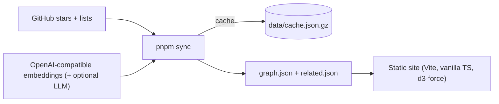

<div align="center">
  <a href="https://github.com/Tendo33/MyNebula">
    
  </a>

  <h1>MyNebula</h1>

  <p>
    <strong>Turn your GitHub Stars into a semantic knowledge nebula you can search, explore, and continuously grow.</strong>
  </p>

  <p>
    <a href="README.zh.md">中文</a> | English
  </p>

  <p>
    <a href="#quick-start">Quick start</a>
    |
    <a href="#architecture">Architecture</a>
  </p>

  <p>
    
    
    <a href="LICENSE"></a>
  </p>

  <p>
    <a href="https://github.com/Tendo33/MyNebula/stargazers"></a>
    <a href="https://github.com/Tendo33/MyNebula/network/members"></a>
    <a href="https://github.com/Tendo33/MyNebula/issues"></a>
    <a href="https://github.com/Tendo33/MyNebula/releases"></a>
  </p>
</div>

<div align="center">
  
</div>

## Why MyNebula

GitHub Stars are useful until they become a pile.

MyNebula helps you turn that pile into a living map of what you care about: clustered by meaning, connected by similarity, and served through a graph you can actually explore. Instead of revisiting old bookmarks one by one, you get a structured view of your interests, a sync pipeline that keeps it fresh, and a frontend designed for browsing ideas rather than scrolling a list.

It is built for people who star heavily, revisit often, and want their repository collection to feel more like a knowledge space than a dumping ground.

## What you get

- **Graph** (home): a live force-directed canvas of your stars. Related repos pull together into groups, nodes drift gently, and hovering or selecting lights up a group and its links. Filter by group, star list, timeline range, or text (`stars:>1000` works too).
- **Details**: AI summary, tags, links to GitHub / DeepWiki / zRead, and related repos (similar, same tags, same language).
- **Data**: a sortable, filterable table of everything.
- **Search** (`⌘K` / `Ctrl+K`) across repos, groups, languages, and tags. English and Chinese UI, light / dark / system theme.

## Architecture

A static site plus an offline pipeline, all TypeScript on Node 24. No server, no database, and the pipeline has zero runtime dependencies.



The pipeline:

1. Fetches every starred repo and your star lists.
2. For new or changed repos only: reads the README, optionally writes an LLM summary and tags, and embeds the result.
3. Links each repo to its most related repos (semantic similarity, shared tags, same star list or language), then groups the graph into communities (Louvain). Group names come from their most distinctive tags, or from the LLM with `--llm-names`. Group ids and names stay stable across syncs.
4. Precomputes related repos and the timeline into static JSON.

Summaries and embeddings are cached, so a daily run only pays for what changed. Layout is not stored: the browser runs the force simulation on the links.

### Free mode

Leave `LLM_API_KEY` empty and the sync makes no chat-model calls: embeddings are built from the description, topics, and a README excerpt, and the details panel shows the original description. What remains is embeddings, which cost very little (models such as `BAAI/bge-m3` on SiliconFlow are priced near zero, though the account needs a positive balance to call them).

## Quick start

```bash
pnpm install
cp .env.example .env    # GITHUB_TOKEN, EMBEDDING_API_KEY, optional LLM_API_KEY
pnpm sync               # writes frontend/public/data/*.json
pnpm dev                # http://localhost:5173
```

| Flag (`pnpm sync -- …`) | Effect |
| --- | --- |
| `--full` | Re-summarize and re-embed every repo |
| `--recluster` | Forget previous group ids and names |
| `--max-clusters N` | Cap on sizable groups, overrides `GRAPH_MAX_CLUSTERS` (default 12) |
| `--llm-names` | Name new groups with the LLM, same as `GRAPH_LLM_NAMES=true` |

`pnpm export` rebuilds links, groups, and JSON from the cache without fetching anything.

## Deploy to GitHub Pages

`.github/workflows/pages.yml` syncs daily, on every push to `main`, and on demand, then publishes `frontend/dist`.

1. Settings → Pages → Source: **GitHub Actions**.
2. Add secrets: `STARS_TOKEN` (a PAT that can read your stars), `EMBEDDING_API_KEY`, and optionally `LLM_API_KEY`.
3. Optionally add variables: `EMBEDDING_BASE_URL`, `EMBEDDING_MODEL`, `LLM_BASE_URL`, `LLM_MODEL`, `LLM_OUTPUT_LANGUAGE`, `GRAPH_MAX_CLUSTERS`, `GRAPH_LLM_NAMES`.
4. Run **Sync and Deploy** from the Actions tab. Pass `--full` or `--recluster` in the input when needed.

The published site is public, and so is your star data. To keep it private, host `frontend/dist` behind an access layer such as Cloudflare Access. Any static host works: the build uses relative paths and hash routing.

## Project structure

```text
pipeline/          sync.ts (CLI, cache), remote.ts (GitHub + models), graph.ts (scores, links, output), cluster.ts (Louvain, naming)
frontend/src/      main.ts shell, store, router, palette, pages/, graph/ (canvas + styles)
.github/workflows/ ci.yml (types, tests, build), pages.yml (sync + deploy)
```

## Development

```bash
pnpm lint && pnpm test && pnpm build
```

## License

MIT, see [LICENSE](LICENSE).
