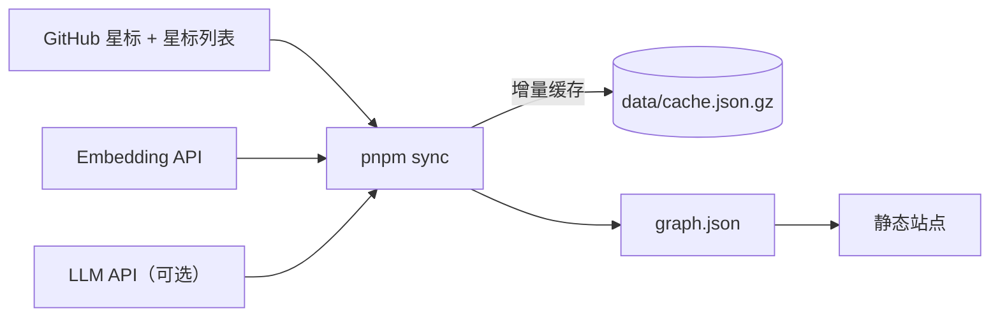

<div align="center">
  <a href="https://github.com/Tendo33/MyNebula">
    
  </a>

  <h1>MyNebula</h1>

  <p><strong>把 GitHub 星标变成一张会动的语义图谱：相关的仓库自然聚在一起，按联系探索，而不是翻列表。</strong></p>

  <p>中文 | <a href="README.md">English</a></p>

  <p>
    
    
    
    <a href="LICENSE"></a>
  </p>
</div>


## 这是什么

MyNebula 读取你的 GitHub 星标，为每个仓库写一段简短摘要，并把它和最相似的几个仓库连起来。这些连线同时决定了节点在画布上的位置和它属于哪个聚类，所以「智能体框架」「文档解析」这样的分组会自己浮现出来，不需要手动打标签。

它是一个静态站点加一条离线同步，没有服务端，也没有数据库：GitHub Actions 每天跑一次同步并重新部署到 GitHub Pages。每次只处理新增或有变化的星标，所以保持更新几乎不花钱。


## 功能

- **图谱**（首页）：实时力导向画布。加载时各个聚类向外展开，随后落定并缓慢漂浮。悬停仓库时预览它所在的聚类，选中仓库时只点亮与它相连的仓库。
- **筛选**：按聚类、GitHub 星标列表、时间区间或文本筛选，也支持 `stars:>1000`。所有筛选和选中状态都写在 URL 里，可以直接分享。
- **详情**：摘要、标签、GitHub / DeepWiki / zRead 链接，以及相关仓库：图上与它相连的仓库（按连线强度排序），以及同标签、同语言的仓库。
- **数据**：可排序、可筛选的完整仓库表格。
- **搜索**：`⌘K` / `Ctrl+K` 搜索仓库、聚类、语言和标签。
- 中英文界面，浅色 / 深色 / 跟随系统主题，支持键盘操作和「减少动态效果」。

## 工作方式



1. **拉取**全部星标仓库和你的星标列表。
2. **加工**：只处理新增或有变化的仓库。读取 README，可选地用 LLM 生成摘要和标签，再计算向量。
3. **连线**：把每个仓库连向最相关的几个仓库。相关度由向量相似度（65%）、共同标签（20%）、同一星标列表（10%）和同一语言（5%）组成。
4. **分组**：在连线图上做社区发现（Louvain）。聚类编号、颜色和名字在多次同步之间保持稳定。
5. **导出**静态 JSON。布局由浏览器根据连线实时计算，不存储任何坐标。

流水线大约 1,200 行 TypeScript，由 Node 24 直接运行，没有任何运行时依赖。站点只依赖 `d3-force`。

## 快速开始

需要 Node 24+、pnpm、一个 GitHub token 和一个 embedding API key。

```bash
git clone https://github.com/Tendo33/MyNebula.git
cd MyNebula
pnpm install
cp .env.example .env   # 填 GITHUB_TOKEN 和 EMBEDDING_API_KEY，可选 LLM_API_KEY
pnpm sync              # 生成 frontend/public/data/
pnpm dev               # http://localhost:5173
```

作为参考：225 个星标、带 LLM 摘要的首次同步大约 5 分钟；第二次同步全部复用缓存，几秒完成，没有任何付费调用。

## 配置

所有配置都来自环境变量，`.env.example` 里逐项有注释。

| 变量 | 默认值 | 作用 |
| --- | --- | --- |
| `GITHUB_TOKEN` | 必填 | 读取你的星标和星标列表。 |
| `EMBEDDING_API_KEY` | 必填 | Embedding 服务的 key。 |
| `EMBEDDING_BASE_URL` | `https://api.siliconflow.cn/v1` | 任何兼容 OpenAI 接口的服务。 |
| `EMBEDDING_MODEL` | `BAAI/bge-m3` | 多语言模型，中英文混合效果好。 |
| `LLM_API_KEY` | 空 | 开启摘要、标签和 LLM 聚类命名。留空则完全不调用对话模型。 |
| `LLM_BASE_URL` | `https://api.siliconflow.cn/v1` | 任何兼容 OpenAI 接口的对话服务。 |
| `LLM_MODEL` | `Qwen/Qwen3-30B-A3B-Instruct-2507` | 生成摘要和组名的模型。 |
| `LLM_OUTPUT_LANGUAGE` | `zh` | 生成内容的语言：`zh` 或 `en`。 |
| `GRAPH_LLM_NAMES` | `false` | 新聚类用 LLM 命名，而不是取高频标签。 |
| `GRAPH_MAX_CLUSTERS` | `12` | 较大聚类的数量上限。 |
| `SYNC_BATCH_SIZE` | `100` | 每次 embedding 请求、每次保存缓存处理的仓库数。 |
| `SYNC_LLM_CONCURRENCY` | `4` | LLM 并发请求数，遇到 HTTP 429 时调低。 |
| `SYNC_README_MAX_LENGTH` | `10000` | 用于摘要和向量的 README 字符数上限。 |
| `NEBULA_CACHE`、`NEBULA_OUTPUT` | `data/cache.json.gz`、`frontend/public/data` | 缓存和输出路径。 |

### 服务商

- **SiliconFlow**（默认）：一个 key 同时用于 embedding 和 LLM。账户必须有余额，否则即使是价格接近零的模型也会返回 HTTP 402。
- **DeepSeek** 作为 LLM：设置 `LLM_BASE_URL=https://api.deepseek.com`，模型填 DeepSeek 的模型名，例如 `deepseek-chat`。DeepSeek 没有 embedding 接口，embedding 需要另配服务商。
- **不用 LLM**：`LLM_API_KEY` 留空。仓库按描述、话题和 README 计算向量，聚类按最有区分度的标签命名，只有 embedding 产生费用。
- **Ollama**（仅本地）：把 `EMBEDDING_BASE_URL` 指向 `http://localhost:11434/v1`，模型用 `nomic-embed-text` 等。GitHub Actions 上不可用。

## 命令

| 命令 | 作用 |
| --- | --- |
| `pnpm sync` | 拉取、加工新增或变化的星标、连线、分组，并写出站点数据。 |
| `pnpm export` | 只用缓存重新计算连线、分组和站点数据，不调用任何 API。 |
| `pnpm dev` / `pnpm build` | 运行或构建站点。 |
| `pnpm lint` / `pnpm test` | 类型检查和测试。 |

`pnpm sync` 和 `pnpm export` 的参数写在 `--` 后面，例如 `pnpm sync -- --full`：

| 参数 | 作用 |
| --- | --- |
| `--full` | 重新生成全部摘要和向量。 |
| `--llm-names` | 本次运行用 LLM 给新聚类命名。 |
| `--recluster` | 丢弃之前的聚类编号和名字。 |
| `--max-clusters N` | 覆盖 `GRAPH_MAX_CLUSTERS`。 |

## 部署到 GitHub Pages

`.github/workflows/pages.yml` 会在每天 UTC 01:00（北京时间 09:00）、每次推送到 `main`、以及手动触发时运行同步，然后发布站点。

1. Fork 本仓库。
2. **Settings › Pages**：Source 选 **GitHub Actions**。
3. **Settings › Secrets and variables › Actions** 的 **Secrets** 里添加：`STARS_TOKEN`（你的 GitHub token）、`EMBEDDING_API_KEY`，可选 `LLM_API_KEY`。
4. 在 **Variables** 里添加与默认值不同的配置，例如 `LLM_BASE_URL`、`LLM_MODEL`、`GRAPH_LLM_NAMES=true`。
5. **Actions › Sync and Deploy › Run workflow**。输入框可以填同步参数，例如 `--full`。

同步缓存保存在 Actions cache 里，所以定时运行始终是增量的。如果缓存被清理，下一次运行会重建缓存，相当于付费跑一次全量同步。

**隐私**：发布出去的站点是公开的，包括你星标仓库的摘要。如果要私有，可以把 `frontend/dist` 部署在 Cloudflare Access 之类的访问控制后面。任何静态托管都能用，构建产物使用相对路径和 hash 路由。

## 常见问题

| 现象 | 原因与处理 |
| --- | --- |
| GitHub 返回 `401` / `Bad credentials` | token 过期或被撤销，重新生成一个。 |
| Embedding 或 LLM 返回 `401` / `Token is invalid` | key 填错或已作废。 |
| 返回 `402` / `balance is insufficient` | 服务商账户没有余额，充值或换服务商。 |
| 生成摘要时出现 `429` | 调低 `SYNC_LLM_CONCURRENCY`。 |
| 星标列表缺失 | 列表请求重试后仍失败，会保留上一次的列表，下次同步自动补上。权限较少的 token 可能读不到列表；实测可用的是带 `repo` 和 `user` 权限的 classic token。 |
| 图谱是空的 | 还没有站点数据。运行 `pnpm sync`，或检查 token 能否读取你的星标。 |

## 项目结构

```text
pipeline/          sync.ts（CLI、缓存）、remote.ts（GitHub 与模型调用）、
                   graph.ts（打分、连线、输出）、cluster.ts（Louvain、命名）
frontend/src/      main.ts（外壳）、store、router、palette、pages/、graph/（画布与样式）
.github/workflows/ ci.yml（类型、测试、构建）、pages.yml（同步与部署）
```

## 开发

```bash
pnpm lint && pnpm test && pnpm build
```

设计规范见 [DESIGN.md](DESIGN.md)，产品背景见 [PRODUCT.md](PRODUCT.md)，给 AI 助手的协作说明见 [AGENTS.md](AGENTS.md)。

## 许可证

MIT，见 [LICENSE](LICENSE)。
