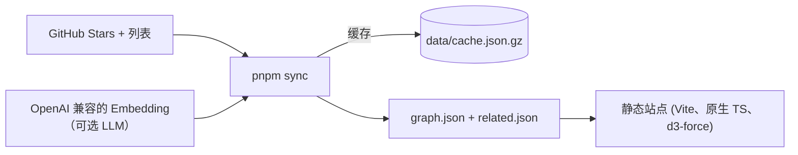

<div align="center">
  <a href="https://github.com/Tendo33/MyNebula">
    
  </a>

  <h1>MyNebula</h1>

  <p>
    <strong>把你的 GitHub Stars 变成一片可搜索、可探索、可持续生长的语义知识星云。</strong>
  </p>

  <p>
    中文 | <a href="README.md">English</a>
  </p>

  <p>
    <a href="#快速开始">快速开始</a>
    |
    <a href="#系统架构">系统架构</a>
  </p>

  <p>
    
    
    <a href="LICENSE"></a>
  </p>

  <p>
    <a href="https://github.com/Tendo33/MyNebula/stargazers"></a>
    <a href="https://github.com/Tendo33/MyNebula/network/members"></a>
    <a href="https://github.com/Tendo33/MyNebula/issues"></a>
    <a href="https://github.com/Tendo33/MyNebula/releases"></a>
  </p>
</div>

<div align="center">
  
</div>

## 为什么是 MyNebula

GitHub Stars 在数量少的时候很好用，数量一多就很容易变成一堆难以回看的收藏。

MyNebula 想做的，就是把这些零散的星标仓库整理成一张真正能浏览的知识地图。它会按语义把仓库聚成主题，把相似项目连接起来，再通过图谱界面把它们呈现出来。这样你不需要再一条条翻收藏记录，而是可以从更高的视角理解自己关注过什么、哪些方向彼此相关、最近又新增了哪些兴趣点。

它更适合这样一类人：经常 star、确实会回看、并且希望自己的收藏不只是“仓库列表”，而是一套可以持续积累的个人知识空间。

## 功能

- **图谱**（首页）：实时力导向画布。相关的仓库互相吸引成组，节点缓慢漂浮；悬停或选中时点亮所在分组和连线。可按分组、星标列表、时间线区间或文本筛选，也支持 `stars:>1000`。
- **详情**：AI 摘要、标签、GitHub / DeepWiki / zRead 链接，以及相关仓库（相似、同标签、同语言）。
- **数据**：可排序、可筛选的完整表格。
- **搜索**（`⌘K` / `Ctrl+K`）覆盖仓库、分组、语言和标签。中英文界面，浅色 / 深色 / 跟随系统主题。

## 系统架构

静态站点加一条离线流水线，全部是运行在 Node 24 上的 TypeScript。没有服务端，没有数据库，流水线没有任何运行时依赖。



流水线做这几件事：

1. 拉取全部星标仓库和星标列表。
2. 只处理新增或有变化的仓库：读取 README，可选地用 LLM 生成摘要和标签，再计算向量。
3. 给每个仓库连上和它最相关的仓库（语义相似、共同标签、同一星标列表或同一语言），再把这张图分成社区（Louvain）。组名取组内最有区分度的标签，加 `--llm-names` 则由 LLM 命名。分组编号和名字在多次同步之间保持稳定。
4. 预先计算相关仓库和时间线，写成静态 JSON。

摘要和向量都会缓存，每天的运行只为变化的部分付费。布局不存储，浏览器直接在连线上跑力导向。

### 免费模式

`LLM_API_KEY` 留空时，同步不调用任何对话模型：向量由描述、话题和 README 片段生成，详情面板显示原始描述。SiliconFlow 上的 `BAAI/bge-large-zh-v1.5` 等 Embedding 模型是免费的，因此整条流水线可以零成本运行。

## 快速开始

```bash
pnpm install
cp .env.example .env    # 填 GITHUB_TOKEN、EMBEDDING_API_KEY，可选 LLM_API_KEY
pnpm sync               # 生成 frontend/public/data/*.json
pnpm dev                # http://localhost:5173
```

| 参数（`pnpm sync -- …`） | 作用 |
| --- | --- |
| `--full` | 重新生成全部摘要和向量 |
| `--recluster` | 丢弃之前的分组编号和名字 |
| `--max-clusters N` | 较大分组的数量上限，覆盖 `GRAPH_MAX_CLUSTERS`（默认 12） |
| `--llm-names` | 用 LLM 给新分组命名，等同 `GRAPH_LLM_NAMES=true` |

`pnpm export` 只用缓存重新计算连线、分组和 JSON，不拉取任何数据。

## 部署到 GitHub Pages

`.github/workflows/pages.yml` 每天、每次推送到 `main`、以及手动触发时运行同步，然后发布 `frontend/dist`。

1. Settings → Pages → Source 选 **GitHub Actions**。
2. 添加 Secrets：`STARS_TOKEN`（能读取你星标的 PAT）、`EMBEDDING_API_KEY`，可选 `LLM_API_KEY`。
3. 按需添加 Variables：`EMBEDDING_BASE_URL`、`EMBEDDING_MODEL`、`LLM_BASE_URL`、`LLM_MODEL`、`LLM_OUTPUT_LANGUAGE`、`GRAPH_MAX_CLUSTERS`、`GRAPH_LLM_NAMES`。
4. 在 Actions 页面运行 **Sync and Deploy**。需要时在输入框里填 `--full` 或 `--recluster`。

发布出去的站点是公开的，星标数据也一样公开。如果要私有访问，可以把 `frontend/dist` 放在 Cloudflare Access 之类的访问控制后面。任何静态托管都能用：构建产物使用相对路径和 hash 路由。

## 项目结构

```text
pipeline/          sync.ts（CLI、缓存）、remote.ts（GitHub 与模型）、graph.ts（打分、连线、输出）、cluster.ts（Louvain、命名）
frontend/src/      main.ts 外壳、store、router、palette、pages/、graph/（画布与样式）
.github/workflows/ ci.yml（类型、测试、构建）、pages.yml（同步与部署）
```

## 开发

```bash
pnpm lint && pnpm test && pnpm build
```

## 许可证

MIT，见 [LICENSE](LICENSE)。
